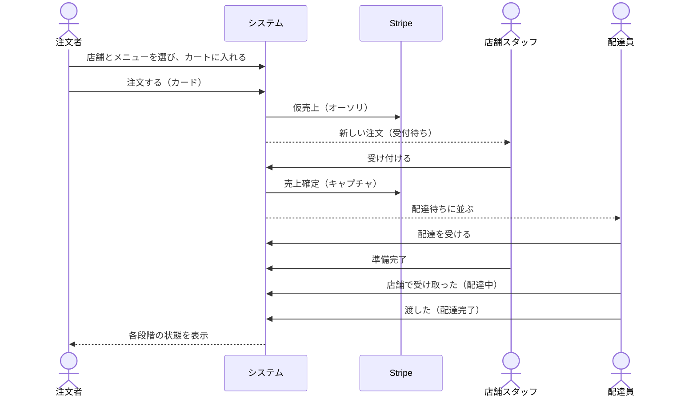
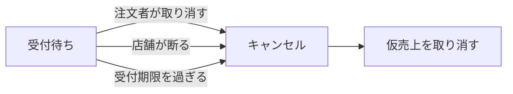

# 要件定義：業務の流れ

状態の名前と遷移の条件は [docs/specs/order-status.md](../specs/order-status.md)、金額や期限の値は [docs/specs/business-rules.md](../specs/business-rules.md) にある。

## 1. 注文から配達完了まで

- 配達員は、店舗が受け付けた時点から配達を受けられる。調理中に店舗へ向かうことで、待ち時間を減らすため。
- 支払いは、注文時に仮売上だけを行い、店舗が受け付けた時点で売上を確定する。店舗が断った場合や受付前にキャンセルされた場合に、返金ではなく仮売上の取り消しで済ませるため。

## 2. 受付前のキャンセル

## 3. 受付後のキャンセル（運営が対応する）

1. 注文者または店舗が、システムの外（電話など）で運営に連絡する。
2. 運営が運営画面で注文をキャンセルし、全額を返金する。
3. 配達員が決まっていた場合は、その配達員の担当から外れる。

## 4. 店舗と配達員の登録

1. 運営が店舗を登録し、店舗スタッフのアカウントを発行する。
2. 店舗スタッフがログインし、メニューを登録して受付中にする。
3. 運営が配達員を登録し、アカウントを発行する。
4. 配達員がアプリでログインし、稼働を始める。
