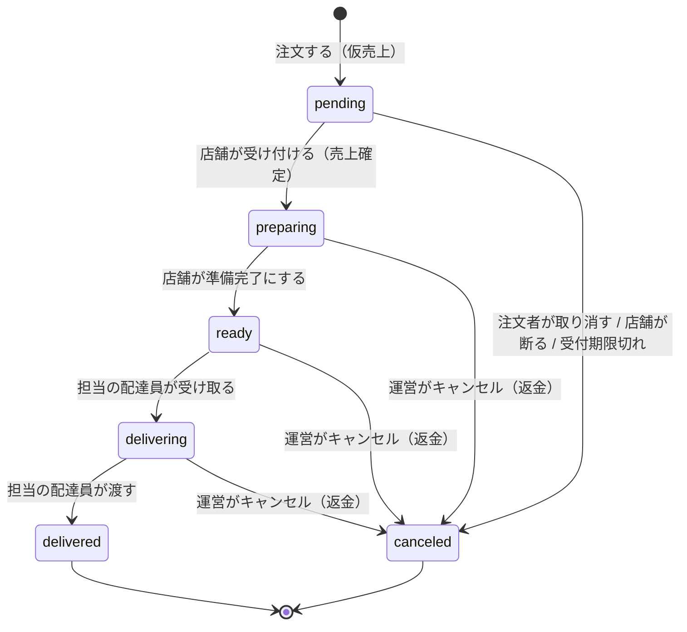

# 仕様：注文の状態

## 状態

| 状態       | コード上の名前 | 意味                                             |
| ---------- | -------------- | ------------------------------------------------ |
| 受付待ち   | `pending`      | 注文され、仮売上が済んだ。店舗の受付を待っている |
| 調理中     | `preparing`    | 店舗が受け付け、売上が確定した                   |
| 準備完了   | `ready`        | 調理が終わり、配達員の受け取りを待っている       |
| 配達中     | `delivering`   | 配達員が店舗で受け取った                         |
| 配達完了   | `delivered`    | 配達員が注文者に渡した                           |
| キャンセル | `canceled`     | 取り消された。理由（下表）を記録する             |

配達員が決まっているかどうかは、状態とは別に「担当の配達員」として持つ。調理中・準備完了で担当の配達員がいない注文を「配達待ち」と呼ぶ。

## 遷移

| 遷移                                  | 操作する人           | 条件                            | 決済         | ルール     |
| ------------------------------------- | -------------------- | ------------------------------- | ------------ | ---------- |
| → 受付待ち                            | 注文者               | R-01〜R-04, R-09, R-10 を満たす | 仮売上       | R-05       |
| 受付待ち → 調理中                     | 店舗スタッフ         | 受付期限内                      | 売上確定     | R-05, R-06 |
| 受付待ち → キャンセル                 | 注文者               | —                               | 仮売上の取消 | R-07       |
| 受付待ち → キャンセル                 | 店舗スタッフ（断る） | —                               | 仮売上の取消 | R-05       |
| 受付待ち → キャンセル                 | システム             | 受付期限を過ぎた                | 仮売上の取消 | R-06       |
| 調理中 → 準備完了                     | 店舗スタッフ         | —                               | —            | —          |
| 準備完了 → 配達中                     | 担当の配達員         | 担当の配達員がいる              | —            | R-12       |
| 配達中 → 配達完了                     | 担当の配達員         | —                               | —            | R-12       |
| 調理中・準備完了・配達中 → キャンセル | 運営                 | —                               | 全額返金     | R-08       |

上の表にない遷移はできない。API は、できない遷移の要求をエラーにする。

## 担当の配達員

| 操作         | 操作する人 | 条件                                                   | ルール |
| ------------ | ---------- | ------------------------------------------------------ | ------ |
| 担当になる   | 配達員     | 注文が配達待ちで、配達員が稼働中かつ担当中の注文がない | R-11   |
| 担当から外す | 運営       | 注文が配達完了・キャンセルではない                     | R-11   |

## キャンセルの理由

| 理由                 | コード上の名前   |
| -------------------- | ---------------- |
| 注文者が取り消した   | `customer`       |
| 店舗が断った         | `store_rejected` |
| 受付期限切れ         | `expired`        |
| 運営がキャンセルした | `admin`          |

## 注文者向け参照 API（F-07）

Cookie または Bearer のセッション認証が必要。確認済みメールアドレスを持つ注文者のみ利用でき、応答は `Cache-Control: no-store` とする。

| エンドポイント    | 応答型（`@repo/contract`）                                          | 用途                                                                                            |
| ----------------- | ------------------------------------------------------------------- | ----------------------------------------------------------------------------------------------- |
| `GET /orders`     | `CustomerOrderListResponse`（`{ orders: CustomerOrderSummary[] }`） | S-C09。進行中を含む自分の全注文を作成日時の降順、同日時は ID の降順で返す。注文がなければ空配列 |
| `GET /orders/:id` | `CustomerOrderDetailResponse`（`{ order: CustomerOrderDetail }`）   | S-C08。自分の注文だけを返す                                                                     |

`CustomerOrderSummary`（別名 `OrderSummary`）は `id`, `storeId`, `storeName`, `storePhotoUrl`（URL または `null`）, `status`, `total`, `createdAt`（UTC ISO 8601）を持つ。店舗名・店舗写真は現在の店舗情報、金額は注文時の値。`storePhotoUrl` は注文時点の写真や注文商品の写真を保証しない。写真未登録・読み込み失敗時は Web / native とも56pxの代替表示を使い、他の商品写真から推測しない。
`CustomerOrderDetail`（別名 `OrderDetail`）はさらに `address`, `building`, `fulfillment`（`hand_delivery` / `leave_at_door`）, `dropoffLocation`（`front_door` / `delivery_box` / `other` / `null`）, `subtotal`, `deliveryFee`, `items`（`menuItemId`, 注文時の `name`, `unitPrice`, `quantity`）, `deliveryPhotoUrl`（URL または `null`）を持つ。金額は円の整数。

状態は上表の6種類をそのまま返す。S-C08 の「取り消す」は `status === 'pending'` の間だけ表示する（取消操作 API は F-08）。置き配写真は配達完了後だけ表示する契約だが、現在は写真の永続化が未実装のため `deliveryPhotoUrl` は常に `null`。状態変更日時も未保存のため返さない。

不正な注文 ID は `400 VALIDATION_ERROR`、存在しない注文と他人の注文は同じ `404 NOT_FOUND`。未認証は `401 UNAUTHORIZED`、注文者以外・メール未確認・利用停止は既存の認証ルールに従う。注文・明細とも認証ユーザー ID で絞り込み、決済 ID・Stripe 情報・ユーザー ID・座標・内部処理用の値は返さない。

## 注文者による取消 API（F-08 / R-07）

`POST /orders/:id/cancel` は参照 API と同じ認証・認可・ID 検証を使う。本文・冪等キーは不要。同じ注文 ID への再送で再試行できる。成功は `200 CustomerOrderCancellationResponse`（`{ order: { id, status: 'canceled' } }`）。受付後・配達完了・注文者以外の理由で取り消された注文は `409 ORDER_NOT_CANCELABLE`。

注文行を `FOR UPDATE` でロックし、所有者と状態を照合して、`canceled` と理由 `customer` を先にコミットする。その後、再び同じ行をロックして Stripe の manual 仮売上を取り消し、確認済み日時 `paymentVoidedAt` を保存する。店舗受付を実装するときも、同じ注文行をロックし、`pending` を確認してから売上確定する必要がある。

Stripe 取消が未確認の間も注文は `canceled` のまま受付できない。取消失敗・通信断・不明な決済状態では `503 PAYMENT_RECONCILIATION_REQUIRED` を返し、成功とは扱わない。注文者は同じ API を再送して復旧できる。再送では PaymentIntent を取得し、既に取消済みなら重ねて取り消さず確認済み日時を保存する。Stripe 成功後に DB が失敗した場合も同じ手順で復旧する。確認済みなら Stripe を呼ばず成功を返す。自動再試行ジョブは本 API の対象外。

取消前に PaymentIntent ID、通貨、金額、manual capture、未確定の全額仮売上を照合する。売上確定済み等の想定外の状態は自動で返金せず、上記 503 として調査・再照合を必要とする。

## 店舗向け注文 API（F-10）

確認済みの店舗スタッフセッションと現在の所属を各取得・更新で照合し、`/store/orders` の一覧と `/:id` の詳細を返す。全状態を作成日時・ID の降順で返し、画面で受付待ち・調理中・準備完了に分類する。他店と不存在は同じ 404。応答は `no-store`。決済 ID・注文者 ID・座標を公開しない。担当配達員の永続化は未実装なので `courier` は `null`。

`POST /store/orders/:id/accept` は注文から10分未満だけ受付を開始できる。`reject` は受付待ちを店舗拒否として取り消し、`ready` は調理中だけを準備完了にする。表にない遷移は `409 ORDER_INVALID_TRANSITION`。成功時は更新した `StoreOrderDetailResponse` を返す。共有契約に受付期限と決済確認中フラグを含む。

受付は注文行をロックし、開始日時をコミットしてから、再びロックして PaymentIntent を照合・capture する。売上確定の確認後だけ調理中にする。失敗・不明時は受付待ちを維持して `503 PAYMENT_RECONCILIATION_REQUIRED`。同じ受付 API の再送で取得・同一キーによる再試行を行う。開始から23時間以降は capture を再送せず取得のみとし、確認できなければ503を維持する。期限後も既に開始した決済の照合は可能。結果不明の間は注文者取消・店舗拒否を拒否する。注文者取消も同じ注文行をロックするため、取消と capture が同時に進むことはない。

拒否は取消状態と理由を先に保存し、manual 仮売上を取消して確認日時を保存する。応答喪失・DB失敗後は同じ拒否 API で照合する。自動復旧ジョブ・期限切れ自動取消（F-20）は別機能。

## 店舗 Web（S-S02 / S-S03）

注文一覧は受付待ち・調理中・準備完了を分類し、受付待ちを背景色・件数表示で強調する。その他の状態も詳細を参照でき、拒否後の決済取消が未確認なら再確認できる。残り時間は共有契約の受付期限から秒単位で表示し、期限後は新規受付ボタンを無効にする。最終判定は API が行う。

一覧・詳細は表示中5秒ごとに更新する。画面・店舗・利用者の変更や離脱では購読を解除し、古い応答を反映しない。取得失敗時はエラーと再読み込みを表示して操作を止める。変更の結果不明は成功表示せず最新状態を再取得し、同じ操作で再確認する。店舗拒否には確認画面を挟む。決済確認中の受付は期限後も再照合できる。
