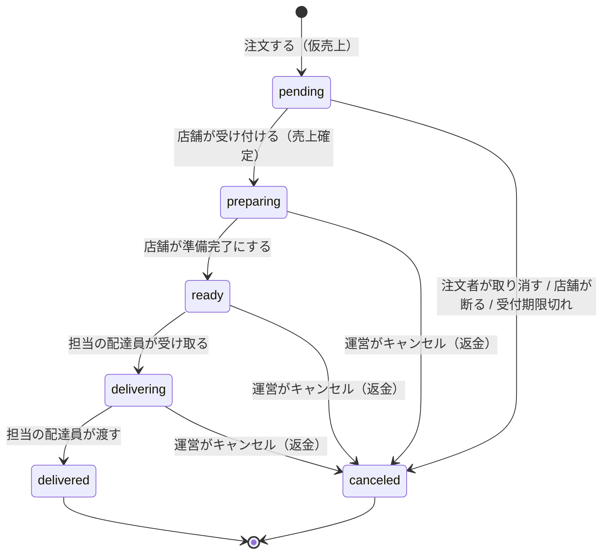

# 仕様：注文の状態

## 状態

| 状態       | コード上の名前 | 意味                                             |
| ---------- | -------------- | ------------------------------------------------ |
| 受付待ち   | `pending`      | 注文され、仮売上が済んだ。店舗の受付を待っている |
| 調理中     | `preparing`    | 店舗が受け付け、売上が確定した                   |
| 準備完了   | `ready`        | 調理が終わり、配達員の受け取りを待っている       |
| 配達中     | `delivering`   | 配達員が店舗で受け取った                         |
| 配達完了   | `delivered`    | 配達員が注文者に渡した                           |
| キャンセル | `canceled`     | 取り消された。理由（下表）を記録する             |

配達員が決まっているかどうかは、状態とは別に「担当の配達員」として持つ。調理中・準備完了で担当の配達員がいない注文を「配達待ち」と呼ぶ。

## 遷移

| 遷移                                  | 操作する人           | 条件                            | 決済         | ルール     |
| ------------------------------------- | -------------------- | ------------------------------- | ------------ | ---------- |
| → 受付待ち                            | 注文者               | R-01〜R-04, R-09, R-10 を満たす | 仮売上       | R-05       |
| 受付待ち → 調理中                     | 店舗スタッフ         | 受付期限内                      | 売上確定     | R-05, R-06 |
| 受付待ち → キャンセル                 | 注文者               | —                               | 仮売上の取消 | R-07       |
| 受付待ち → キャンセル                 | 店舗スタッフ（断る） | —                               | 仮売上の取消 | R-05       |
| 受付待ち → キャンセル                 | システム             | 受付期限を過ぎた                | 仮売上の取消 | R-06       |
| 調理中 → 準備完了                     | 店舗スタッフ         | —                               | —            | —          |
| 準備完了 → 配達中                     | 担当の配達員         | 担当の配達員がいる              | —            | R-12       |
| 配達中 → 配達完了                     | 担当の配達員         | —                               | —            | R-12       |
| 調理中・準備完了・配達中 → キャンセル | 運営                 | —                               | 全額返金     | R-08       |

上の表にない遷移はできない。API は、できない遷移の要求をエラーにする。

## 担当の配達員

| 操作         | 操作する人 | 条件                                                   | ルール |
| ------------ | ---------- | ------------------------------------------------------ | ------ |
| 担当になる   | 配達員     | 注文が配達待ちで、配達員が稼働中かつ担当中の注文がない | R-11   |
| 担当から外す | 運営       | 注文が配達完了・キャンセルではない                     | R-11   |

## キャンセルの理由

| 理由                 | コード上の名前   |
| -------------------- | ---------------- |
| 注文者が取り消した   | `customer`       |
| 店舗が断った         | `store_rejected` |
| 受付期限切れ         | `expired`        |
| 運営がキャンセルした | `admin`          |
