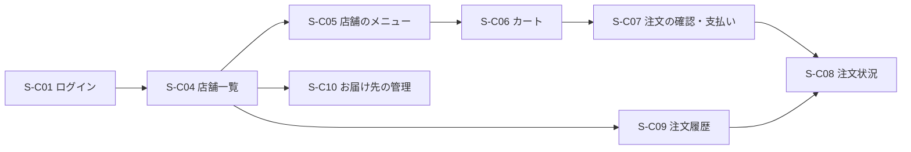

# 仕様：画面一覧

画面の目的と主な項目・操作・遷移だけを書く。配置や見た目は Penpot のワイヤーフレームとデザインを正本にし、作ったら「Penpot」の列にリンクを貼る。

## 注文者（Web・注文者アプリ共通）

Web は `apps/web` の `(customer)`、アプリは `apps/customer-app`。同じ画面 ID で、同じ項目と遷移にする。

| ID    | 画面               | 主な項目・操作                                                         | 遷移先              | 機能       | Penpot |
| ----- | ------------------ | ---------------------------------------------------------------------- | ------------------- | ---------- | ------ |
| S-C01 | ログイン           | メールアドレス、パスワード                                             | S-C04, S-C02, S-C03 | F-01       | —      |
| S-C02 | 会員登録           | 氏名、メールアドレス、パスワード、電話番号。確認メールの案内           | S-C01               | F-01       | —      |
| S-C03 | パスワード再設定   | メールアドレス。再設定メールから新しいパスワード                       | S-C01               | F-01       | —      |
| S-C04 | 店舗一覧（ホーム） | お届け先の切替、配達エリア内の店舗（受付停止中の表示を含む）           | S-C05, S-C10, S-C09 | F-03       | —      |
| S-C05 | 店舗のメニュー     | 店舗の情報、カテゴリごとの商品（売り切れの表示を含む）、カートに入れる | S-C06               | F-04, F-05 | —      |
| S-C06 | カート             | 商品と数量の変更、小計、配達料、合計、最低注文金額の不足の表示         | S-C07               | F-05       | —      |
| S-C07 | 注文の確認・支払い | お届け先、注文内容、合計、カードの入力（Stripe）、注文する             | S-C08               | F-06       | —      |
| S-C08 | 注文状況           | 状態、注文内容、合計、受付待ちの間だけ「取り消す」                     | S-C04               | F-07, F-08 | —      |
| S-C09 | 注文履歴           | 過去の注文の一覧                                                       | S-C08               | F-07       | —      |
| S-C10 | お届け先の管理     | お届け先の一覧・登録・変更・削除                                       | S-C04               | F-02       | —      |
| S-C11 | アカウント         | 登録情報の確認、ログアウト                                             | S-C01               | F-01       | —      |

## 店舗（Web `/store`）

| ID    | 画面         | 主な項目・操作                                                         | 遷移先 | 機能 | Penpot |
| ----- | ------------ | ---------------------------------------------------------------------- | ------ | ---- | ------ |
| S-S01 | ログイン     | メールアドレス、パスワード                                             | S-S02  | F-09 | —      |
| S-S02 | 注文一覧     | 受付待ち・調理中・準備完了ごとの注文。受付待ちは残り時間（R-06）を表示 | S-S03  | F-10 | —      |
| S-S03 | 注文の詳細   | 注文内容、受け付ける・断る、準備完了にする、担当の配達員               | S-S02  | F-10 | —      |
| S-S04 | メニュー一覧 | カテゴリと商品の一覧、売り切れの切替                                   | S-S05  | F-11 | —      |
| S-S05 | 商品の編集   | 商品名、説明、価格、画像、カテゴリ                                     | S-S04  | F-11 | —      |
| S-S06 | 店舗の設定   | 受付中・停止中の切替                                                   | —      | F-12 | —      |

店舗スタッフは店内で画面を開いたままにするため、受付待ちの注文が来たことが S-S02 で目立つようにする。

## 配達員（配達員アプリ）

| ID    | 画面       | 主な項目・操作                                                           | 遷移先              | 機能       | Penpot |
| ----- | ---------- | ------------------------------------------------------------------------ | ------------------- | ---------- | ------ |
| S-D01 | ログイン   | メールアドレス、パスワード                                               | S-D02               | F-13       | —      |
| S-D02 | ホーム     | 稼働中・休止中の切替、配達待ちの注文の一覧（店舗名・お届け先までの距離） | S-D03, S-D04, S-D05 | F-13, F-14 | —      |
| S-D03 | 配達の詳細 | 店舗とお届け先、注文内容、担当になる                                     | S-D04               | F-14       | —      |
| S-D04 | 配達中     | 店舗とお届け先の住所・電話番号、受け取った・渡した                       | S-D02               | F-15       | —      |
| S-D05 | 配達履歴   | 自分が配達した注文の一覧                                                 | —                   | F-15       | —      |

## 運営（Web `/admin`）

| ID    | 画面               | 主な項目・操作                                                         | 遷移先 | 機能 | Penpot |
| ----- | ------------------ | ---------------------------------------------------------------------- | ------ | ---- | ------ |
| S-A01 | ログイン           | メールアドレス、パスワード                                             | S-A02  | F-16 | —      |
| S-A02 | 注文一覧           | 状態・店舗・日付で絞り込み                                             | S-A03  | F-19 | —      |
| S-A03 | 注文の詳細         | 注文内容、状態の履歴、決済の状態、キャンセルと返金、担当の配達員を外す | S-A02  | F-19 | —      |
| S-A04 | 店舗一覧           | 店舗の一覧                                                             | S-A05  | F-17 | —      |
| S-A05 | 店舗の登録・編集   | 店舗の情報、住所、配達半径、最低注文金額、店舗スタッフのアカウント発行 | S-A04  | F-17 | —      |
| S-A06 | 配達員一覧         | 配達員の一覧、稼働状態                                                 | S-A07  | F-18 | —      |
| S-A07 | 配達員の登録・編集 | 配達員の情報、アカウントの発行・停止                                   | S-A06  | F-18 | —      |
